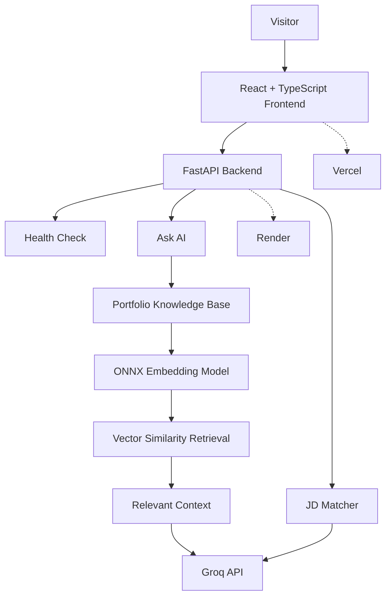

# I. - Personal Portfolio

A minimal, interactive, desktop-inspired personal portfolio built to showcase my profile, projects, technical skills, and resume, with integrated AI-powered features.

**Live Website:** https://ishaan-portfolio-kappa.vercel.app  
**Backend API:** https://i-portfolio-api.onrender.com  
**API Health Check:** https://i-portfolio-api.onrender.com/api/health

---

## Overview

I. is a personal portfolio designed around a minimal desktop-inspired interface. Instead of presenting information through a conventional scrolling portfolio, it organizes different sections into interactive applications accessible through a vertical navigation system.

The project combines a React frontend with a FastAPI backend to deliver a responsive portfolio experience, including an AI-powered portfolio assistant and a Job Description Matcher.

## Features

- **Home:** Introduction and personal profile.
- **Projects:** Showcase of projects and development work.
- **Resume:** Access to professional and academic information.
- **JD Matcher:** Evaluates alignment between a resume and a supplied job description, highlighting matching skills and areas that may need attention.
- **Ask AI:** An AI-powered portfolio assistant that uses ONNX-based semantic retrieval to find relevant information from a curated knowledge base before generating responses through the Groq API.
- **Contact:** Contact information and external profile links.

### Interface and Experience

- Minimal, dark desktop-inspired interface.
- Subtle animated particle background.
- Vertical application navigation with icons and labels.
- Live clock.
- Smooth transitions between sections.
- Responsive layout.
- Social links and shortcuts.

## Technology Stack

| Layer | Technologies |
|---|---|
| Frontend | React, TypeScript, Vite |
| Styling and UI | CSS, Framer Motion, Lucide |
| Backend | Python, FastAPI |
| AI Integration | Groq API |
| Knowledge and Retrieval | Curated Python knowledge base, ONNX embeddings, NumPy vector similarity |
| Deployment | Vercel, Render |
| Version Control | Git, GitHub |

## Architecture

The application follows a frontend-backend architecture, with separate processing flows for the portfolio assistant and Job Description Matcher.



### How It Works

1. Visitors interact with the React frontend.
2. The frontend communicates with the FastAPI backend through API requests.
3. The backend exposes dedicated endpoints for health checks, AI conversations, and job description matching.
4. Ask AI converts the visitor's query into an embedding and retrieves semantically relevant information from the curated portfolio knowledge base.
5. The retrieved context is passed to the Groq API to generate a response grounded in documented portfolio information.
6. The JD Matcher processes a supplied job description and evaluates its alignment with the available resume information.
7. The frontend and backend are deployed independently using Vercel and Render.

## Backend API

The FastAPI backend currently exposes the following endpoints:

| Method | Endpoint | Purpose |
|---|---|---|
| GET | `/api/health` | Backend health check |
| POST | `/api/chat` | Portfolio AI assistant |
| POST | `/api/jd-match` | Job description matching |

The backend also includes CORS configuration and request rate limiting.

## Project Structure

```text
portfolio/
│
├── backend/
│   ├── app/
│   │   ├── main.py
│   │   ├── knowledge.py
│   │   └── embeddings.py
│   │
│   ├── render.yaml
│   └── .env.example
│
├── public/
├── src/
│
├── package.json
├── vercel.json
├── .env.example
└── README.md
```

## Running Locally

### Prerequisites

- Node.js and npm
- Python 3.11+
- A Groq API key

### 1. Clone the Repository

```bash
git clone https://github.com/csequenc/portfolio.git
cd portfolio
```

### 2. Configure the Frontend

Install dependencies:

```bash
npm install
```

The root `.env.example` can be used as a reference for frontend configuration.

For local development, leave `VITE_API_BASE_URL` unset so Vite can proxy API requests to the local backend.

### 3. Configure the Backend

Navigate to the backend directory:

```bash
cd backend
```

Create and activate a virtual environment.

**Windows:**

```powershell
python -m venv .venv
.venv\Scripts\activate
```

**macOS / Linux:**

```bash
python3 -m venv .venv
source .venv/bin/activate
```

Install dependencies using the project's configured Python environment and dependency setup.

Create a `.env` file using `.env.example` as a reference.

Configure the following variables:

```env
GROQ_API_KEY=your_groq_api_key
GROQ_MODEL=openai/gpt-oss-120b
FRONTEND_ORIGINS=http://localhost:5173,http://127.0.0.1:5173
```

Never commit actual API keys or secrets to the repository.

### 4. Start the Backend

From the `backend` directory:

```bash
uvicorn app.main:app --reload --port 8000
```

The backend will be available at:

```text
http://localhost:8000
```

### 5. Start the Frontend

Open another terminal in the project root:

```bash
npm run dev
```

The frontend will be available at:

```text
http://localhost:5173
```

### 6. Production Build

To generate the frontend production build:

```bash
npm run build
```

The generated files will be available in the `dist/` directory.

## Environment Variables

### Frontend

| Variable | Description |
|---|---|
| `VITE_API_BASE_URL` | Base URL of the FastAPI backend. Leave unset for local development. |

### Backend

| Variable | Description |
|---|---|
| `GROQ_API_KEY` | API key used for Groq integration. |
| `GROQ_MODEL` | Model used for AI-powered functionality. |
| `FRONTEND_ORIGINS` | Comma-separated list of permitted frontend origins. |

## Deployment

The application uses separate hosting platforms for the frontend and backend.

| Component | Platform | Deployment |
|---|---|---|
| Frontend | Vercel | https://ishaan-portfolio-kappa.vercel.app |
| Backend | Render | https://i-portfolio-api.onrender.com |

The frontend uses `VITE_API_BASE_URL` to communicate with the deployed backend.

The backend uses `FRONTEND_ORIGINS` to allow requests from the deployed frontend.

## Current Scope and Future Improvements

Version 1 focuses on delivering the core portfolio experience and its integrated AI functionality.

The Ask AI feature currently uses a curated, code-defined portfolio knowledge base with ONNX-based semantic retrieval. This keeps the information controlled, structured, and predictable rather than relying on automatic repository extraction.

Planned improvements include:

- Expanding the portfolio knowledge base with detailed project documentation.
- Updating `knowledge.py` as additional GitHub projects are completed and documented.
- Improving project-specific AI responses with richer technical context.
- Further refinement of the AI assistant and job description matching experience.

Automatic GitHub repository extraction is not part of the current implementation.

## Author

**Ishaan Maheshwari**

- GitHub: https://github.com/csequenc

---

*Built as a personal portfolio and an exploration of interactive frontend design, backend development, and applied AI integration.*
